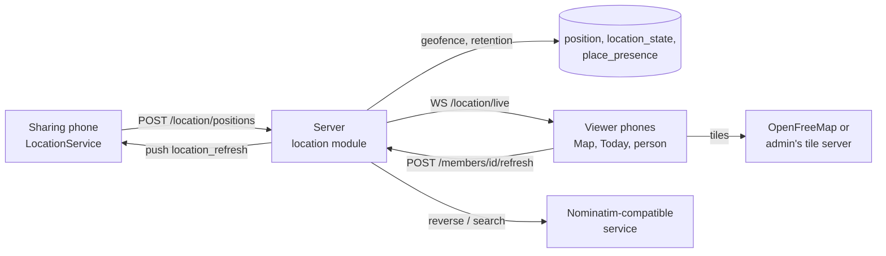

# Location module design (M4)

Technical design for the [location spec](../product/features/location.md). Decisions behind it:
[ADR-0024](../adr/0024-positions-outside-the-sync-log.md) (positions and sharing state outside the sync log, live channel),
[ADR-0025](../adr/0025-location-visibility-rules.md) (visibility rules),
[ADR-0026](../adr/0026-addresses-through-a-server-geocoder.md) (addresses through the server),
[ADR-0027](../adr/0027-map-rendering-maplibre-compose.md) (map rendering),
[ADR-0028](../adr/0028-battery-aware-tracking-service.md) (tracking on the phone),
[ADR-0006](../adr/0006-no-proprietary-dependencies.md) (no Google services). Implemented by plans
[M4-01…M4-10](../plans/README.md#m4-plans).

## Overview

- **Positions are not sync data** (ADR-0024). The sharing phone uploads batches of fixes over REST; the server keeps
  them in `position` (append-only, deleted after retention) and the member's latest state in `location_state`. Viewers
  load "now" and day histories over REST and get live changes over a second WebSocket, `/api/v1/location/live`, which
  the server filters per viewer. Other phones never store positions except a small cache of the last snapshot.
- **Places and arrive/leave subscriptions are sync data**: `place` (family data, `location.view`) and `place_alert`
  (owner-only row of the subscriber, ADR-0023 pattern, derived id).
- **Visibility rules** (ADR-0025) live on the server only (`location_rule`), are edited by administrators over REST and
  evaluated by shared pure code (`LocationVisibility`). They decide which positions a viewer gets; they never touch
  sync data, so no access-version bump is needed.
- **Geofences** are evaluated on the server on every accepted fix (`Geofence`, pure, in the contract), with hysteresis;
  per member and place state in `place_presence`. Notifications go to subscribers who may see the member.
- **Addresses** come from a server-side proxy to a Nominatim-compatible service (ADR-0026), on demand only, cached and
  rate-limited; the administrator can turn it off.
- **The phone** runs one foreground service while sharing (ADR-0028): moving / still modes, significant-motion wake-up,
  uploads from the service, one sharing phone per member, «Обновить» by push and by the upload response.
- **The map** uses maplibre-compose behind an `expect` composable (ADR-0027); the JVM target gets a test stand-in.



## Contract (`contract/…`)

### Sync data (`entities/LocationEntities.kt`)

```kotlin
@Serializable
data class PlaceData(
    val name: String,                     // trimmed, 1..60
    val icon: PlaceIcon = PlaceIcon.PLACE, // lenient, fallback PLACE
    val latitude: Double,                 // -90..90
    val longitude: Double,                // -180..180
    val radiusM: Int = 100,               // 50..1000
    val address: String? = null,          // trimmed, blank -> null, ≤ 200; display only (from the search)
    val createdBy: String,                // member id; set on create, never changes
)

@Serializable
enum class PlaceIcon { HOME, SCHOOL, WORK, SPORT, SHOP, PLACE } // keys "home", "school", "work", "sport", "shop", "place"

@Serializable
data class PlaceAlertData(
    val memberId: String,                 // the watched member; never changes
    val subscriberId: String,             // the writer; never changes; != memberId
    val placeIds: Set<String> = emptySet(), // ≤ 50; empty = no alerts; arrive and leave together (LOC-021)
)
```

- `EntityTypes.PLACE = "place"`, `PLACE_ALERT = "place_alert"`.
- `Ids.placeAlertRowId(memberId, subscriberId)`: the derivation of `Ids.reminderRowId` with `memberId` as the base id, the
  salt from bytes 8..15 of `subscriberId` and marker `b[7] xor 0x3C` (reminders use `0x5A`). `derive` takes the marker
  as an `Int` (0 = none). `tools/dev/seed.py` implements the same function.
- `PlaceIcon` follows the `EventKind` pattern (`key`, `fromKey`, lenient serializer). Icons: `home`, `school`, `work`,
  `fitness_center`, `shopping_cart`, `location_on`.

### REST DTOs (`api/location/LocationDtos.kt`)

```kotlin
@Serializable data class PositionFix(
    val recordedAt: Instant,              // device time of the fix, UTC
    val latitude: Double, val longitude: Double,
    val accuracyM: Float,                 // 0..10000
    val speedMps: Float? = null,          // 0..100
    val bearingDeg: Float? = null,        // 0..360
    val altitudeM: Double? = null,
    val battery: Int? = null,             // 0..100
    val charging: Boolean? = null,
)
@Serializable data class UploadPositionsRequest(val positions: List<PositionFix>)          // 1..200, any order
@Serializable data class UploadPositionsResponse(
    val accepted: Int,
    val sharingHere: Boolean,             // false: another phone of the member shares, or no SHARING state -> stop here
    val paused: Boolean = false,          // the member is paused (positions were dropped)
    val pausedUntil: Instant? = null,
    val refreshRequested: Boolean = false, // somebody pressed «Обновить» and no fix was received since
)

@Serializable enum class SharingStatus { NEVER, SHARING, PAUSED, OFF_ON_PHONE }   // lenient, fallback NEVER
@Serializable enum class OffReason { LOCATION_DISABLED, PERMISSION_REVOKED, STOPPED, SIGNED_OUT } // lenient, fallback STOPPED
@Serializable data class SetSharingRequest(
    val status: SharingStatus,            // SHARING | PAUSED | OFF_ON_PHONE (NEVER -> VALIDATION_FAILED)
    val pausedUntil: Instant? = null,     // PAUSED only; null = until resumed; must be in the future, ≤ now + 7 days
    val reason: OffReason? = null,        // OFF_ON_PHONE only (REQUIRED there)
)

@Serializable enum class VisibilityLevel { NONE, CURRENT, HISTORY }   // keys "none", "current", "history"; lenient NONE

@Serializable data class MemberLocation(
    val memberId: String,
    val level: VisibilityLevel,           // CURRENT or HISTORY (the viewer's level for this member)
    val status: SharingStatus,
    val pausedUntil: Instant? = null,
    val offReason: OffReason? = null,
    val statusSince: Instant? = null,
    val last: PositionFix? = null,        // newest stored fix (also while paused / off: the last before)
    val placeId: String? = null,          // a place the member is inside (smallest radius wins)
    val placeSince: Instant? = null,
)
@Serializable data class LocationNow(val members: List<MemberLocation>, val serverTime: Instant)

@Serializable data class TrackPoint(val recordedAt: Instant, val latitude: Double, val longitude: Double, val accuracyM: Float)
@Serializable data class LocationHistory(val memberId: String, val date: LocalDate, val points: List<TrackPoint>)

@Serializable data class LiveMessage(
    val type: String,                     // "snapshot" | "member" | "gone"
    val now: LocationNow? = null,         // snapshot
    val member: MemberLocation? = null,   // member
    val memberId: String? = null,         // gone: no longer visible
) { companion object { const val SNAPSHOT = "snapshot"; const val MEMBER = "member"; const val GONE = "gone" } }

@Serializable data class RuleParty(val kind: PartyKind, val id: String? = null)    // id: group or member id; null for EVERYONE
@Serializable enum class PartyKind { EVERYONE, GROUP, MEMBER, UNKNOWN }             // lenient, fallback UNKNOWN: such a rule matches nothing
@Serializable data class LocationRule(val id: String, val subject: RuleParty, val target: RuleParty, val level: VisibilityLevel)
@Serializable data class LocationRules(val rules: List<LocationRule>)
@Serializable data class LocationRuleInput(val subject: RuleParty, val target: RuleParty, val level: VisibilityLevel)
@Serializable data class PutLocationRulesRequest(val rules: List<LocationRuleInput>) // ≤ 100; replaces all

@Serializable data class Watcher(val memberId: String, val level: VisibilityLevel)
@Serializable data class AlertWatcher(val memberId: String, val placeIds: Set<String>)
@Serializable data class LocationWatchers(val viewers: List<Watcher>, val alerts: List<AlertWatcher>)

@Serializable data class LocationConfig(
    val mapStyleUrl: String, val mapDarkStyleUrl: String,
    val addresses: Boolean,               // the geocoder is configured
    val historyDays: Int,
)
@Serializable data class AddressLabel(val label: String? = null)
@Serializable data class AddressResult(val label: String, val latitude: Double, val longitude: Double)
@Serializable data class AddressSearch(val results: List<AddressResult>)
```

`HouseholdData` gets `locationHistoryDays: Int = 30` and `UpdateHouseholdRequest` gets `locationHistoryDays: Int? = null`
(one of `LocationLimits.HISTORY_DAYS_CHOICES = [7, 14, 30, 60, 90]`, else `VALIDATION_FAILED` `OUT_OF_RANGE`).

### Notifications

- `NotificationType.LOCATION_PLACE` (`location.place`, channel `family_activity`) — arrive / leave.
- `NotificationType.LOCATION_SHARING` (`location.sharing`, channel `family_activity`) — sharing off / back, to
  administrators.
- `PushPayload.KIND_LOCATION_REFRESH = "location_refresh"` — data-only, to one session.

### Pure logic (`location/`)

```kotlin
object LocationLimits {
    const val MAX_UPLOAD = 200; const val MAX_FIX_AGE_HOURS = 24; const val MAX_FUTURE_SKEW_MINUTES = 5
    const val STALE_MINUTES = 30; const val MOVING_SPEED_MPS = 2f; const val MOVING_MAX_AGE_MINUTES = 5
    const val REFRESH_COOLDOWN_SECONDS = 60; const val MAX_RULES = 100; const val MAX_HISTORY_POINTS = 3000
    val HISTORY_DAYS_CHOICES = listOf(7, 14, 30, 60, 90); const val DEFAULT_HISTORY_DAYS = 30
    const val MIN_RADIUS_M = 50; const val MAX_RADIUS_M = 1000; const val DEFAULT_RADIUS_M = 100
}

object Geo {
    fun distanceM(lat1: Double, lon1: Double, lat2: Double, lon2: Double): Double // haversine, R = 6_371_008.8 m
    fun circle(lat: Double, lon: Double, radiusM: Double, points: Int = 48): List<Pair<Double, Double>> // polygon ring, closed
}

data class VisibilityViewer(val memberId: String, val isAdmin: Boolean, val canView: Boolean, val groupIds: Set<String>)
data class VisibilityTarget(val memberId: String, val groupIds: Set<String>)
object LocationVisibility {
    fun level(viewer: VisibilityViewer, target: VisibilityTarget, rules: List<LocationRule>): VisibilityLevel
    fun defaultRules(adultsGroupId: String, kidsGroupId: String): List<LocationRuleInput>
}
```

`level`: `!canView` → NONE; `viewer.memberId == target.memberId` → HISTORY; `isAdmin` → HISTORY; else the highest level
of the rules whose subject matches the viewer (EVERYONE; GROUP in `viewer.groupIds`; MEMBER == viewer) and whose target
matches the target the same way; none → NONE. Defaults: Adults → EVERYONE, HISTORY; Kids → GROUP Adults, CURRENT.

```kotlin
enum class Transition { ARRIVED, LEFT }
data class PresenceState(
    val inside: Boolean?,                 // null = unknown (new place, new member, place moved)
    val since: Instant?,
    val candidate: Boolean? = null,       // a reading that differs from `inside`, waiting for confirmation
    val candidateSince: Instant? = null,
)
object Geofence {
    fun margin(radiusM: Int): Double = max(25.0, 0.2 * radiusM)
    fun usable(accuracyM: Float, radiusM: Int): Boolean = accuracyM <= max(radiusM, 100)
    fun reading(distanceM: Double, accuracyM: Float, radiusM: Int): Boolean? // true if d ≤ r; false if d − acc > r + margin; else null
    fun step(state: PresenceState, reading: Boolean?, at: Instant): Pair<PresenceState, Transition?>
}
```

`step`: `reading == null` → state unchanged (a pending candidate stays). `state.inside == null` → `inside = reading`,
`since = at`, no transition (first knowledge never notifies). `reading == state.inside` → candidate cleared. Otherwise:
no candidate or a different one → `candidate = reading, candidateSince = at`; the same candidate again (second
consecutive reading) → `inside = reading`, `since = candidateSince`, candidate cleared, transition ARRIVED / LEFT.
Fixes are fed in `recordedAt` order; fixes failing `usable` are skipped. A transition's time (`at`) is the confirmed
`since`, i.e. the time of the first agreeing reading.

```kotlin
data class Stop(val start: Instant, val end: Instant, val latitude: Double, val longitude: Double,
                val placeId: String?, val ongoing: Boolean)
object Stops {
    const val RADIUS_M = 100.0; const val MIN_DURATION_MINUTES = 10; const val MAX_ACCURACY_M = 100f
    fun detect(points: List<TrackPoint>, places: List<Pair<String, PlaceData>>, ongoingAfter: Instant?): List<Stop>
}
```

`detect`: points with accuracy ≤ 100 m, sorted. A cluster starts at a point; following points within 100 m of the
cluster's first point extend it; a point outside closes it. A closed cluster spanning ≥ 10 min is a stop with the mean
position; `placeId` = the place (smallest radius) whose circle contains the mean; `ongoing` = the cluster holds the last
point and `ongoingAfter` (now − 30 min) is before its end. Adjacent stops at the same place within 15 min merge.

### Write rules (`permissions/PlaceRules.kt`, `WriteRules`)

`WriteRules.canMutate`: `PLACE` → `location.manage_places` (upsert and delete; implies `location.view`);
`PLACE_ALERT` → `UPSERT && location.view`, DELETE false.

```kotlin
object PlaceRules {
    fun canManage(viewer: Viewer): Boolean                               // location.manage_places
    fun canCreate(viewer: Viewer, place: PlaceData): Boolean             // canManage && createdBy == me
    fun canSetAlert(viewer: Viewer, alert: PlaceAlertData): Boolean      // location.view && subscriberId == me && memberId != me
}
```

### Validation (`Validators.place`, `.placeAlert`; `normalizePlace`)

| Field | Codes |
| --- | --- |
| `name` | `REQUIRED`, `TOO_LONG` (60) |
| `latitude`, `longitude` | `OUT_OF_RANGE` |
| `radiusM` | `OUT_OF_RANGE` outside 50..1000 |
| `address` | `TOO_LONG` (200) |
| `placeIds` | `OUT_OF_RANGE` above 50 |
| `memberId` (alert) | `INVALID_FORMAT` when equal to `subscriberId` |
| `PositionFix` (`Validators.positionFix`) | `OUT_OF_RANGE` for coordinates, accuracy, speed, bearing, battery |
| `SetSharingRequest` | `status`: `INVALID_FORMAT` for NEVER; `pausedUntil`: `INVALID_FORMAT` unless PAUSED, `OUT_OF_RANGE` in the past or > 7 days; `reason`: `REQUIRED` for OFF_ON_PHONE, `INVALID_FORMAT` otherwise |
| `LocationRuleInput` | `rules.N.subject` / `.target`: `INVALID_FORMAT` (id with EVERYONE, missing id, unknown kind); `rules`: `OUT_OF_RANGE` above 100 |

### Implementation notes (M4-01)

- `Validators.setSharing(request, now)` takes the current time for the `pausedUntil` checks; `Validators.positionFix`
  checks value ranges only, the age and future-skew limits are the server's (M4-03).
- `LocationLimits` also holds the field limits used by the validators (`PLACE_NAME_MAX`, `PLACE_ADDRESS_MAX`,
  `MAX_ALERT_PLACES`, `MAX_ACCURACY_M`, `MAX_SPEED_MPS`, `MAX_BEARING_DEG`, `MAX_PAUSE_DAYS`); `Geo.EARTH_RADIUS_M` and
  `Stops.MERGE_GAP_MINUTES` (15) are public constants.
- `Stops.detect` merges only stops with the same non-null place; the merged stop's position is the mean of all its
  points.
- `tools/dev/seed.py` has `place_alert_row_id` with a golden value shared with `IdsTest`.

## Server (package `app.lares.server.location`)

### Configuration (`AppConfig`)

| Variable | Default | Meaning |
| --- | --- | --- |
| `LARES_MAP_STYLE_URL` | `https://tiles.openfreemap.org/styles/liberty` | Map style (light) |
| `LARES_MAP_STYLE_DARK_URL` | `https://tiles.openfreemap.org/styles/dark` | Map style (dark) |
| `LARES_GEOCODER_URL` | `https://nominatim.openstreetmap.org` | Nominatim-compatible base URL; set but empty = addresses off |
| `LARES_GEOCODER_EMAIL` | — | Optional contact sent as `email=` (Nominatim policy) |

`AppConfig.location: LocationConfigValues(mapStyleUrl, mapDarkStyleUrl, geocoderUrl: String?, geocoderEmail: String?)`;
URLs must be `https://` (or `http://` for `localhost`/`127.0.0.1`, tests). Both `deploy/.env.example` and the server
`environment:` block of `deploy/docker-compose.yml` list them. The geocoder URL is **not** read with `value()` (which
treats blank as "default"): `env["LARES_GEOCODER_URL"]` null → default, `""` → off (`geocoderUrl = null`); compose
passes it as `${LARES_GEOCODER_URL-https://nominatim.openstreetmap.org}` (no colon, so an empty value stays empty).
`testDeps()` sets `geocoderUrl = null`; address tests point it at a fake server. Tests never reach the internet.

### Tables

`V9__location_places.sql` (M4-02):

- `place(id uuid PK, household_id, name, icon text, latitude double precision, longitude double precision, radius_m int,
  address NULL, created_by uuid → member, seq, created_at, updated_at, deleted)` + `(household_id, seq)`.
- `place_alert(id uuid PK, household_id, member_id uuid → member, subscriber_id uuid → member, place_ids text '[]', seq,
  created_at, updated_at, deleted)` + `(household_id, seq)` + `(member_id)`.
- `location_rule(id uuid PK, household_id → household, subject_kind text, subject_group_id uuid NULL → group_entity
  ON DELETE CASCADE, subject_member_id uuid NULL → member ON DELETE CASCADE, target_kind text, target_group_id …,
  target_member_id … (same), level text, position int, created_at)` + `(household_id)`. Not syncable. Groups and members
  are tombstoned, so the cascade only matters when housekeeping hard-deletes old tombstones; live deletes are explicit.
  V9 inserts use `gen_random_uuid()`.
- `household.location_history_days int NOT NULL DEFAULT 30`.
- Default rules for existing households: for each household, insert the two defaults when groups named
  `Adults`/`Взрослые` and `Kids`/`Дети` exist (by name, case-insensitive; template groups carry no marker).

`V10__location_positions.sql` (M4-03):

- `position(id bigint GENERATED ALWAYS AS IDENTITY PK, household_id, member_id → member, session_id uuid NULL,
  recorded_at timestamptz, latitude, longitude double precision, accuracy_m real, speed_mps real NULL, bearing_deg real
  NULL, altitude_m double precision NULL, battery smallint NULL, charging bool NULL, received_at timestamptz)` +
  `UNIQUE (member_id, recorded_at)` (idempotent re-upload) + index `(household_id, recorded_at)`.
- `location_state(member_id uuid PK → member, household_id, status text, paused_until timestamptz NULL, off_reason text
  NULL, status_since timestamptz, sharing_session_id uuid NULL, last_* columns (recorded_at, latitude, longitude,
  accuracy_m, speed_mps, bearing_deg, altitude_m, battery, charging) NULL, refresh_requested_at timestamptz NULL,
  refresh_sent_at timestamptz NULL, updated_at)`.

`V11__location_presence.sql` (M4-04):

- `place_presence(member_id → member, place_id → place ON DELETE CASCADE, household_id, inside bool NULL, since
  timestamptz NULL, candidate bool NULL, candidate_since timestamptz NULL, PRIMARY KEY (member_id, place_id))`.

### Sync handlers (M4-02)

- `PlaceSyncHandler`, `PlaceAlertSyncHandler`, registered after the calendar handlers.
- `place`: `authorize` with `PlaceRules`; `createdBy` immutable; `canSee` → `location.view`; tombstone also deletes the
  place's `place_presence` rows (after M4-04) and publishes `LocationHub.PlacesChanged`.
- `place_alert`: derived id check (`requireDerivedId`), `memberId`/`subscriberId` immutable, writer == subscriber,
  `memberId` a live member of the household (`ENTITY_NOT_FOUND`), added `placeIds` live places (`requireAddedPlaces`);
  `canSee` → `location.view` and `data.subscriberId == viewer.memberId` (tombstones to all); client deletes `FORBIDDEN`.
- Housekeeping purges `place_alert`, then `place`.
- `removeMember` tombstones (with `recordChange`) the `place_alert` rows whose `member_id` or `subscriber_id` is the
  member, so subscribers' phones drop them.

### Visibility service (M4-02)

`LocationVisibilityService(db)`:

- `rules(tx, householdId): List<LocationRule>`; `put(householdId, request)` replaces all rules in one transaction
  (checks every group / member id belongs to the household and is live, else `VALIDATION_FAILED` `rules.N.subject|target:
  INVALID_FORMAT`), then publishes `LocationHub.VisibilityChanged(householdId)` after commit.
- `levels(tx, householdId, viewerMemberId): Map<memberId, VisibilityLevel>` for all live members (one query for rules,
  groups and memberships; permissions through `PermissionService.effectiveInTransaction`).
- `level(tx, householdId, viewer, targetMemberId)`.
- Routes (`LocationAdminRoutes.kt`, `household.manage`): `GET /api/v1/location/rules` → `LocationRules`,
  `PUT /api/v1/location/rules` → 204.
- `SetupService.createHousehold` inserts `LocationVisibility.defaultRules(adults, kids)`.
- Group delete (a tombstone) → `GroupAdminService.delete` deletes the rules naming the group; member removal
  (`removeMember`) deletes rules naming the member and the member's positions, state and presence (no sharing notice).
  Both already record a change, so `HouseholdChangeBus` triggers the live recompute; no `VisibilityChanged` publish and
  no constructor changes there. Only `LocationVisibilityService.put` (no recorded change) publishes `VisibilityChanged`.
- `PATCH /household` accepts `locationHistoryDays`.

### Implementation notes (M4-02)

- Every place write (create, edit, delete) publishes `PlacesChanged` after commit, not only the tombstone: a moved or
  resized place changes where members are shown. `LocationHubEvent` carries `householdId`; `SessionEnded` is added in M4-03.
- Rule rows are read and written by `LocationRuleRepository` (`all`, `replace`, `deleteNamingGroup`, `deleteNamingMember`);
  `SetupService` and the group and member hooks call it directly. `LocationVisibilityService(db, clock, hub)`.
- `levels()` evaluates the viewer's permissions from the same `GroupRepository.loadViews` it uses for group ids (one load).
- A self-alert is `FORBIDDEN` (`PlaceRules.canSetAlert` in `authorize` runs before the validator).
- `requireDerivedId` moved from `calendar/CalendarChecks.kt` to `sync/ReferenceChecks.kt` (shared by calendar and location).
- V9 matches template names with `lower(name) IN ('взрослые', lower('Взрослые'), 'adults')`, so the exact names match
  even under a database locale where `lower()` leaves Cyrillic unchanged.

### Positions, state, live channel (M4-03)

`LocationService(db, clock, visibility, hub, notifications, notifier?)`. `LocationConfig.addresses` is true when a geocoder is configured (M4-04). Endpoints in `LocationRoutes.kt`, all authenticated:

| Method, path | Who | Behaviour |
| --- | --- | --- |
| `PUT /location/me/sharing` | any member | SHARING: state SHARING, `sharing_session_id` = caller's session, `status_since` = now if it changed; PAUSED: needs `location.pause_own` (`FORBIDDEN`), allowed from any own session, state PAUSED with `paused_until`, `sharing_session_id` unchanged; OFF_ON_PHONE: only from the sharing session (other sessions: 204, nothing); already OFF_ON_PHONE with another reason → `off_reason` updated, `status_since` kept, no new notice; 204 |
| `POST /location/positions` | any member | see below; 200 `UploadPositionsResponse` |
| `GET /location/now` | `location.view` | `LocationNow` of every live member with level ≥ CURRENT (always including the viewer) |
| `GET /location/history?memberId&date` | `location.view` | level NONE → `NOT_FOUND`; CURRENT → `FORBIDDEN`; date outside the retention window → empty; points of that household-local day, accuracy ≤ 200 m, thinned to at most `MAX_HISTORY_POINTS` including the last point (every k-th from the first, k = ceil((n − 1) / 2999), plus the last) |
| `POST /location/members/{id}/refresh` | `location.view`, level ≥ CURRENT | `NOT_FOUND` if not visible; status ≠ SHARING → `CONFLICT`; sets `refresh_requested_at = now`; sends the push only if `refresh_sent_at` is older than 60 s; 202 |
| `GET /location/me/watchers` | any member | `LocationWatchers`: members (not me) with level ≥ CURRENT for me; `place_alert` rows with `memberId` = me, non-empty live `placeIds`, whose subscriber still sees me |
| `GET /location/config` | any member | `LocationConfig` |
| WS `/location/live` | `location.view` | live channel, below |

**Effective state** (`LocationStateRepository.effective(row, now)`, used by upload, `now`, live, refresh and watchers):
PAUSED with `paused_until ≤ now` is SHARING with `status_since = paused_until`; the upload also stores it so.

**Concurrency**: upload, `PUT /me/sharing` and refresh start with `SELECT … FROM location_state WHERE member_id = ? FOR
UPDATE` (inserting a NEVER row first when missing, `ON CONFLICT DO NOTHING`), so the state and presence rows of one
member are written by one transaction at a time.

**Upload** (`POST /location/positions`, `MAX_UPLOAD` fixes, else `VALIDATION_FAILED`):

1. Effective state: PAUSED with `paused_until ≤ now` counts as SHARING (and is stored so, `status_since = paused_until`).
2. No state or `sharing_session_id ≠ caller` → `accepted = 0, sharingHere = false`.
3. PAUSED → `accepted = 0, paused = true, pausedUntil`.
4. Drop fixes failing validation, older than 24 h or more than 5 min in the future; insert the rest `ON CONFLICT DO
   NOTHING`; update `last_*` when the newest is newer than the stored one.
5. OFF_ON_PHONE and a fix arrives → state SHARING (the notifier sends "back", M4-04).
6. Geofences (M4-04) for the new fixes in order.
7. `refreshRequested` compares server times only: a fix stored in this request (its `received_at` is after
   `refresh_requested_at`) clears `refresh_requested_at`; the response says `refreshRequested = refresh_requested_at !=
   null`. Device clocks never take part, so a phone with a wrong clock cannot loop.
8. After commit: `LocationHub.MemberChanged(householdId, memberId)` when `last_*`, state or presence changed.

**Live channel** (`LocationLiveService`): the connection first subscribes to both flows (`onSubscription`, as
`SyncEventsService`), then computes the viewer's levels and sends a `snapshot` (same content as `GET /now`). It collects
`LocationHub.events` (an in-process `MutableSharedFlow`, buffer 256, drop oldest) and `HouseholdChangeBus`, filtered by
household:

- `MemberChanged(memberId)` → one `dbQuery` loads the `MemberLocation` **and** a fresh
  `visibility.level(tx, viewer → member)`; sent only when ≥ CURRENT (cached levels are never trusted for sending).
- `VisibilityChanged`, `PlacesChanged`, `HouseholdChangeBus` events (groups and memberships change through recorded
  changes) → recompute levels (debounced 500 ms); when the levels map changed: `gone` for members that dropped to NONE,
  then a `snapshot`; on `PlacesChanged` a `snapshot`; otherwise nothing (a shopping tick sends nothing).
- `SessionEnded(sessionId)` for the connection's session → close with code 4401. Every 60 s the connection re-checks
  that its session is not revoked and its member is live, else closes.

Clients send nothing; ping 30 s like `/sync/events`. Messages are sent only to the connection's member: nothing reaches
a viewer that may not see the member, nor a signed-out phone.

**Refresh push**: `NotificationService.sendToSession(sessionId, PushPayload(kind = KIND_LOCATION_REFRESH), ttl = 2.minutes,
urgency = High)` (new; uses `activeTargets(sessionId eq …)`); `refresh_sent_at = now`.

**Sessions ending**: every path that revokes sessions calls `LocationSessions` in its transaction —
`AuthService.logout`, `AccountService.revokeSession`, both revoke branches of `AuthService.refresh` (expired refresh,
reuse detection) → `onSessionEnded(tx, sessionId)`; `MemberAdminService.resetPassword` (`revokeAllOfUser`) →
`onUserSessionsEnded(tx, userId)`. A `sharing_session_id` among them → OFF_ON_PHONE / SIGNED_OUT,
`sharing_session_id = null` (M4-04 notifies). Each also publishes `LocationHub.SessionEnded(sessionId)` after commit
(closes live sockets). `removeMember` does **not** call them: it deletes the member's location rows instead (no notice).

**Retention** (`LocationRetentionJob`, started with the other jobs when `backgroundJobs`): every hour, per household,
`DELETE FROM position WHERE household_id = ? AND recorded_at < now − location_history_days` in batches of 10 000, and
clears the `last_*` columns of `location_state` rows whose `last_recorded_at` is before the same cutoff (their `/now`
entry then has a status and no `last`). `runOnce(now)` for tests. Positions are never in logs (conventions).

### Implementation notes (M4-03)

- History thinning keeps exactly `MAX_HISTORY_POINTS` evenly spaced points by index (first and last included,
  `PositionRepository.thin`): the "every k-th" formula of the plan gives about 2 000 points for 6 000, not the
  3 000 the plan's test expects. The day's lower bound is also clamped to the retention cutoff.
- `accepted` counts fixes stored by this request; a re-sent fix (same member and `recordedAt`) is not counted and does
  not answer «Обновить» (it arrived before the request).
- `LocationService(db, clock, config, visibility, hub, notifications, permissions)`: `permissions` checks
  `location.pause_own`; `snapshot(tx, …)` and `memberFor(tx, …)` are shared by `GET /now` and the live channel.
- `LocationVisibilityService.viewersOf(tx, household, target)` evaluates every live member's level for one target from
  one load of rules and groups (watchers; M4-04 notifications reuse it).
- `onUserSessionsEnded` runs before `revokeAllOfUser`, so only sessions that were live get `SessionEnded`.
- An upload or refresh for a member without a state row inserts the NEVER row first (the lock); a rejected refresh rolls it back.
- The refresh push is sent after the commit and before the 202 answer.
- The retention job clears `last_*` without publishing `MemberChanged`; open maps show the old point until reconnect.
- Live channel: changed members queue in a channel (256, drop oldest), recomputes are conflated; close codes are
  `LocationLiveService.CLOSE_SIGNED_OUT` (4401) and `CLOSE_FORBIDDEN` (4403). `location.view` is checked once on connect;
  losing it later gives `gone` for everybody and an empty snapshot on the next recompute.
- `AppConfig.location: LocationConfigValues`; tests use `testConfig()` (testFixtures), which switches addresses off.

### Geofences, notifications, addresses (M4-04)

- `LocationGeofencing.apply(tx, householdId, memberId, fixes)`: loads live places of the household and the member's
  presence rows; for each fix in order and each place: `Geofence.usable` → `reading` → `step`; upserts changed rows;
  returns transitions with `(placeId, transition, at)`. A place whose centre or radius changes resets its presence rows
  (`inside = null`) in `PlaceSyncHandler.update`.
- `MemberLocation.placeId/placeSince` come from rows with `inside = true` (smallest radius).
- `LocationNotifier` (the `TaskNotifier` pattern, `afterCommit` → channel → consumer):
  - `PlaceTransition(householdId, memberId, placeId, transition, at)`: only when `at ≥ now − 15 min` (an offline backlog
    updates presence silently). Recipients: live members with a `place_alert` row for this member containing the place,
    `location.view`, level ≥ CURRENT for the member, not the member. Type `LOCATION_PLACE`, `entityType = "location"`,
    `entityId = memberId`.
  - `SharingOff(householdId, memberId, reason)` when the state becomes OFF_ON_PHONE from SHARING or PAUSED, and
    `SharingBack` when it becomes SHARING from OFF_ON_PHONE — only if the member lacks `location.pause_own`.
    Recipients: administrators, not the member. Type `LOCATION_SHARING`, same entity.
- Texts (`NotificationTexts`, no grammatical gender — member names carry none):

| Kind | Title ru / en | Body ru / en |
| --- | --- | --- |
| arrived | «Аня · Школа №12» / "Аня · Школа №12" | «Прибытие в 08:52» / "Arrived at 08:52" |
| left | «Аня · Школа №12» | «Уход в 14:20» / "Left at 14:20" |
| off, LOCATION_DISABLED | «Геопозиция выключена» / "Location off" | «Тимур · геопозиция выключена на телефоне» / "Тимур · location is off on the phone" |
| off, PERMISSION_REVOKED | same | «Тимур · у приложения нет доступа к геопозиции» / "Тимур · the app has no location access" |
| off, STOPPED | same | «Тимур · передача остановлена» / "Тимур · sharing was stopped" |
| off, SIGNED_OUT | same | «Тимур · выход из приложения» / "Тимур · signed out of the app" |
| back | «Геопозиция снова передаётся» / "Location sharing is back" | «Тимур» |

  Times in the household zone, `HH:mm`.
- **Addresses** (ADR-0026): `AddressLookup` interface (`reverse(lat, lon, language): String?`, `search(query, language,
  near: Pair<Double, Double>?): List<AddressResult>`), implemented by `NominatimLookup(http: java.net.http.HttpClient,
  baseUrl, email, userAgent)`:
  - reverse: `GET {base}/reverse?format=jsonv2&lat=…&lon=…&zoom=18&layer=address&addressdetails=1&accept-language=…`;
    label = `road` + `, ` + `house_number` (if any); without a road: `pedestrian`, `footway`, `neighbourhood`, `suburb`,
    `village`, `town`, `city` (first present); nothing → null.
  - search: `GET {base}/search?format=jsonv2&q=…&limit=5&addressdetails=1&accept-language=…` (+ `viewbox` of ±0.5° around
    `near`, not bounded); label = the short label + `, ` + city/town/village when known.
  - User-Agent `Lares/<version> (+https://github.com/hiraise/Lares)`, `email` when configured, timeouts 5 s.
  - `AddressService(lookup?, clock)`: in-memory LRU caches (reverse 5 000 entries keyed by coordinates rounded to 4
    decimals ≈ 11 m and language, 7 days; search 500 entries, 1 day); one request per second for the whole server
    (a `Mutex` + last-request time; a caller waiting longer than 5 s gets null / empty); failures cached for 10 min.
  - Endpoints: `GET /location/address?lat&lon` (`location.view`; 60 per member per minute, else `RATE_LIMITED`) →
    `AddressLabel`; `GET /location/search?q` (`location.manage_places`; q trimmed 3..200; 10 per minute) →
    `AddressSearch`. Geocoder off → `label = null` / empty results. Language: the member's push language or the
    household's `defaultLanguage`.
  - The server never geocodes on its own (no job, no per-fix lookup): only when a phone asks for a shown position.

### Implementation notes (M4-04)

- `LocationGeofencing` keeps presence for every live place of the household; `currentPlaces` fills
  `MemberLocation.placeId/placeSince` in `GET /now`, the live channel and its snapshots, whatever the sharing status
  (a paused member shows the place of the last position). Every upload that stores a fix publishes `MemberChanged`.
- Rows of a place go when it is tombstoned (`PlaceSyncHandler.tombstone`) and by `ON DELETE CASCADE` when housekeeping
  purges it; rows of a member go in `MemberRemoval`.
- `LocationNotifier(db, visibility, notifications)` loads the household's groups once per event; recipients of
  `location.place` are the subscribers whose level from `viewersOf` is ≥ CURRENT (NONE covers gone members and missing
  `location.view`). `LocationNotifier.ENTITY_TYPE = "location"`. `LocationSessions` needs the notifier, so
  `AppDeps` builds the push and notification services first.
- `AddressLookup.reverse` / `search` give null for a failure and also for "nothing found"; `AddressService` keeps both
  (and an empty search) for 10 minutes. The one-request-per-second gate reserves a time slot and waits for it outside
  any lock, so a slow answer does not hold the next request; `interval` and `maxWait` are constructor parameters (tests
  use milliseconds), the slot uses the monotonic clock, cache expiry the server clock.
- Search prefers the area of the household's first live place (by creation), rounded to 0.1° before it is sent
  (`viewbox` ±0.5°); without places no `viewbox`. The language is normalized to `en` / `ru` like notification texts.
- Rate limits reuse `FailedAttemptLimiter` (every request counts, per member). `NominatimLookup` follows redirects
  (not https → http) and takes a `timeout` parameter (5 s; tests shorter).

## Client

### Local tables (`5.sqm`, schema 6, `DATA_SCHEMA_VERSION = 5`)

`place(id PK, name, icon TEXT, latitude REAL, longitude REAL, radius_m INTEGER, address TEXT NULL, created_by)`;
`place_alert(id PK, member_id, subscriber_id, place_ids TEXT (JSON))`; `position_outbox(id INTEGER PK AUTOINCREMENT,
recorded_at TEXT, json TEXT)`; `location_pref(key TEXT PK, value TEXT)`; `location_snapshot(key TEXT PK, json TEXT,
fetched_at TEXT)`. All in `LocalDb.clearAll()`. The local `household` table gets no new column: the history period is read from
`config().historyDays` (refreshed after an admin changes it).

### Core (`data/location/`)

- `PlaceAdapter`, `PlaceAlertAdapter` (same rules and checks as the server).
- `PlacesRepository(localDb, permissions)`: `observePlaces()`, `observeMyAlerts()`; `PlacesWriter(writer, localDb,
  clock)`: `create(draft): String`, `update(id, data)` (changed fields only), `delete(id)`, `setAlert(memberId,
  placeIds)` (derived row; empty set = off).
- `LocationApi` calls in `LaresApi`: `setSharing`, `uploadPositions`, `locationNow`, `history`, `refresh`, `watchers`,
  `locationConfig`, `address`, `searchAddress`, `locationRules`, `putLocationRules`, `locationLive(): Flow<LiveMessage>`.
- `LocationRepository(api, localDb, members, persons, places, permissions, household, syncEngine, clock,
  ticks = minuteTicks(clock), live: () -> Flow<LiveMessage> = api::locationLive, timings: LocationTimings =
  LocationTimings())` (`LocationTimings(backoffInitial = 2 s, backoffMax = 1 min, pollInterval = 60 s)`, like
  `SyncConfig`; MockEngine cannot do WebSockets, so tests pass `live`):
  - `observeNow(): Flow<MapState>` — while collected: opens `live()` (reconnect with backoff); while the socket is down,
    polls `GET /now`; OFFLINE when `SyncStatus` is offline or both the socket and the poll fail with an I/O error → the
    cached state. The merged state is written to `location_snapshot` (key `now`) after messages, at most once per 30 s;
    a `gone` removes the member from the cache at once; `FORBIDDEN` or losing `location.view` deletes the cache (no hidden
    position stays on the phone). Joins members, persons (name, color), places; ticks recompute stale and age texts
    every minute.
  - `refresh(memberId): Result<Unit>`, `history(memberId, date): Result<DayHistory>` (points + `Stops.detect`),
    `address(lat, lon): String?` (memory cache, same rounding as the server; null when addresses are off),
    `search(query)`, `config()` (cached in `location_pref`), `watchers()`, `rules()`, `saveRules()`.
- Models: `MapState(members: List<MemberOnMap>, places: List<Place>, me: MySharing, connection: Connection,
  updatedAt)`, `MemberOnMap(memberId, personId, name, color, level, status, pausedUntil, offReason, last, place,
  placeSince, stale, moving)`; `LocationTexts(resources: LocationTextResources)`: status lines (spec LOC-003…LOC-014,
  NEVER «Не делится геопозицией»), age («сейчас» < 2 min, «N мин назад» < 60, «в 14:20» today, «вчера в 14:20», «12 окт.
  в 14:20»), battery level class. `LocationTextResources` is a suspend interface like `CalendarReminderTexts`:
  `EnglishLocationTexts` in `coreModule()`, `LocationResourceTexts` (`ui/common/`, `loc_status_*` strings en/ru) bound in
  `uiModule()`; no language parameter.
- **Sharing on this phone** — `SharingController(api, localDb, tracking: LocationTracking, device: LocationDevice,
  queue, poster: NotificationPoster, texts: LocationTextResources, household, clock, scope)`; state in
  `location_pref`: `enabled` (this phone), `paused_until` / `paused_forever`, `pending` (a `SetSharingRequest` not yet
  sent), `last_upload_ok`, `last_fix_at`, `reported_off`:
  - `enable()`: `PUT SHARING` (online required; offline → error «Нужна сеть»), then `tracking.start()`.
  - `pause(choice)`: `HOUR` (now + 1 h), `MORNING` (next 08:00 household time), `FOREVER`; stores locally, tells the
    tracker at once, sends `PUT PAUSED` (kept in `pending` and retried by the uploader when offline).
  - `resume()`: local + `PUT SHARING`. An expired local pause resumes by itself (the service checks every minute).
  - `reportOff(reason)` once per reason until sharing works again; `disable()` (sign-out, another phone took over).
  - `onUpload(response)`: `!sharingHere` → `disable()` + local notice «Геопозицией теперь делится другой телефон»;
    `paused` → local pause; `refreshRequested` → `onRefreshRequest()`.
  - `onRefreshRequest()` (from the upload response and the `location_refresh` push): calls `tracking.freshFix()` only
    when sharing is enabled here and not paused locally; otherwise nothing (a pause not yet sent never leaks a fix).
  - `observe(): Flow<MySharing>` (`OFF`, `SHARING`, `PAUSED(until?)`, `NEEDS_PERMISSION`, `STALE_UPLOADS`).
- `PositionQueue(localDb)`: `add(fix)`, `batch(max)`, `remove(ids)`, `trim(now)` (drop > 24 h, keep ≤ 5 000).
  `PositionUploader(api, queue, controller, clock)`: `flush(): Boolean` (sends `pending` first, then batches of 200;
  backoff 30 s → 5 min on failure).
- `TrackingPolicy` (pure, below) and the platform interface:

```kotlin
interface LocationTracking {          // implemented in client/android; no-op in the core and tests
    fun start(); fun stop(); fun freshFix(); fun pauseChanged()
}
interface LocationDevice {            // permissions and settings, Android implementation
    fun status(): DeviceLocationStatus   // fine, background, locationOn, notifications, batteryUnrestricted, significantMotion
    fun backgroundOptionLabel(): String  // «Разрешить в любом режиме» etc. from PackageManager
    fun openAppSettings(); fun openLocationSettings(); fun requestIgnoreBatteryOptimizations(); fun openBatterySettings()
    val manufacturer: String
}
```

### Tracking policy (`TrackingPolicy`, ADR-0028)

| Mode | Platform request | Recording | Upload |
| --- | --- | --- | --- |
| MOVING (start mode; also after a resume) | `fused` (API 31+ when present) else `gps`; high accuracy, interval 10 s, min interval 5 s | a fix with accuracy ≤ 200 m when ≥ 30 s since the last recorded or ≥ 50 m from it | when the oldest queued fix is ≥ 30 s old or 20 are queued |
| STILL | same provider, interval 15 min (5 min without a significant-motion sensor), min interval 5 min; high accuracy on API 36+, balanced below; plus `passive` | every fix (heartbeat with battery) | right after each recorded fix |
| PAUSED | none | none | pending state only |

- MOVING → STILL: at least 3 fixes in the last 3 minutes, all within 75 m of their mean and with speed < 1 m/s (when
  reported).
- STILL → MOVING: the significant-motion trigger fires; or a fix (passive or heartbeat) ≥ 150 m from the still anchor
  with accuracy ≤ 100 m; or sharing resumes.
- «Обновить»: a one-shot high-accuracy `getCurrentLocation` (timeout 45 s), recorded regardless of the thresholds and
  uploaded at once; the mode does not change.
- Every recorded fix carries battery level and charging (`BatteryManager`).
- Pure API: `TrackingPolicy(clock)` with `onFix(fix): Decision(record: Boolean, newMode: Mode?)`, `onSignificantMotion()`,
  `onPause/onResume`, `request(mode, sdk, hasMotionSensor): TrackingRequest`, `shouldUpload(queueOldest, queueSize, mode)`.

### Implementation notes (M4-06)

- `position_outbox.recorded_at` is epoch milliseconds (INTEGER): ISO texts with and without fractions of a second do
  not sort.
- `LaresApi.requestLocationRefresh(memberId)` («Обновить»): `refresh` already names the token refresh. `locationLive()`
  shares the `events()` token path; a close with 4403 throws `ApiException(FORBIDDEN)`, 4401 `SESSION_REVOKED`.
- `LocationRepository(api, localDb, members, places, permissions, syncEngine, scope, clock, sharing, ticks, live,
  timings)`: names and colors come from `MembersRepository` (already joined with persons), the household is not needed;
  `scope` is the app scope for `shareIn`, `sharing` is `SharingController.observe()` for `MapState.me`. Connection:
  LIVE while the socket delivers, POLLING while it connects or is down, OFFLINE when `SyncStatus` is offline or both
  the socket and the poll failed with an I/O error. The poll starts only after a socket failure. Members are sorted by
  name. `LocationTimings.cacheInterval` (30 s); the cache is also written when the last collector leaves.
- `config(reload)` returns `LocationConfig?` (memory, then `location_pref` `config` offline); `address()` returns null
  without caching on network errors.
- `LocationTexts.status(member, address, now, zone, places)`: the place comes from `member.place`; `places` give the
  nearest place when there is no address («2 км от дома», others «350 м от места «Школа №12»» — place names have no
  genitive). A sharing member without any fix shows «Нет данных». Since texts: «с 15:10», «со вчера, 15:10»,
  «с 12 окт.»; a pause end more than a day ahead shows the date. `formatDistance` rounds to 10 m below 1 km, one
  decimal below 10 km. `BatteryLevel` LOW ≤ 15, MEDIUM ≤ 50, HIGH.
- `SharingController(…, scope, ticks)`: `enable()`, `pause()`, `resume()` return `Result`; offline enable fails with
  `NeedsNetworkException`. A pause the server refuses (no `location.pause_own`) is undone on the phone. `checkPause()`
  is the minute check of the service. `onFixRecorded(at)` stores `last_fix_at`. `sendPending()` drops a request the
  server refuses (it cannot succeed later). `MySharing.StaleUploads` needs a stored `last_upload_ok` (never-uploaded
  phones show Sharing).
- `PositionUploader.flush(force = false)`: `force` skips the backoff (network back, «Обновить» fix). Batches answered
  `sharingHere = false` or `paused` are removed from the queue (the server dropped them for good).
- `TrackingPolicy`: STILL needs 3 minutes in MOVING (since the last mode change) besides ≥ 3 fixes within 75 m; the
  accuracy limit of 200 m applies in STILL too; `request(…, hasFused = true)`; `onFreshFix(fix)` marks the «Обновить»
  fix as the last recorded. Platform interfaces: `NoopLocationTracking`, `AllowAllLocationDevice` (JVM, tests);
  `DeviceLocationStatus.canShare` = fine + background + location on.
- Dev tools: `seed.py location` keeps `sessions` (access + refresh token per seeded member), `olga_id` and `location`
  (place ids) in `seed.json`; `emu.sh route` sends `geo fix LON LAT 150 8 5` (5 knots ≈ walking fast). `geo fix`
  reaches the `gps` provider; that the AOSP `fused` provider passes it on is to be confirmed in M4-07 (nothing
  requested locations before; if not, the service uses `gps` on the emulator).

### Android (`client/android/…/location/`)

- Manifest: `ACCESS_FINE_LOCATION`, `ACCESS_COARSE_LOCATION`, `ACCESS_BACKGROUND_LOCATION`,
  `FOREGROUND_SERVICE_LOCATION`, `REQUEST_IGNORE_BATTERY_OPTIMIZATIONS`; service `.location.LocationService`
  (`foregroundServiceType="location"`, not exported); receiver for the notification actions.
- `LocationService` (a plain `Service` with its own `CoroutineScope`; process-wide
  `LocationService.running: StateFlow<Boolean>`): `startForeground(1002, notification, FOREGROUND_SERVICE_TYPE_LOCATION)`;
  notification channel `location` (LOW importance, created in `createNotificationChannels`): «Вы делитесь геопозицией»
  (paused: «Пауза до 15:30») with actions «Пауза на 1 час» (only with `location.pause_own`) / «Продолжить»; tap opens Map.
  Drives `TrackingPolicy` with `LocationManagerCompat`, `SensorManager.requestTriggerSensor(TYPE_SIGNIFICANT_MOTION)`,
  `PositionQueue`, `PositionUploader`, a `ConnectivityManager` callback (flush on network back) and a
  `LocationManager.PROVIDERS_CHANGED_ACTION` receiver (location off → `reportOff(LOCATION_DISABLED)`; on → resume).
  `START_STICKY`; a null intent (sticky restart) means START. The notification icon is a copy of the generated
  `location_on` vector in `client/android/src/main/res/drawable/ic_notification_location.xml`.
- `AndroidLocationTracking.start()` starts the service from the visible app. Every start outside the visible app (boot,
  push, worker) needs background location and is wrapped in `try/catch (ForegroundServiceStartNotAllowedException,
  SecurityException)` → `reportOff(STOPPED)` once (API 31+ exempts boot and apps with battery optimization off, not
  pushes or workers). `freshFix()` sends a plain intent when `running`, else does nothing.
- Restarts: `RescheduleRemindersReceiver` (`BOOT_COMPLETED`, `MY_PACKAGE_REPLACED`) and `SyncWorker` call
  `LocationResume.check()`: sharing enabled here and the service not running → start it if allowed, else `reportOff`
  (`PERMISSION_REVOKED` / `LOCATION_DISABLED` / `STOPPED`) and post «Передача геопозиции остановлена — откройте Lares»
  (channel `system`).
- `PushMessageHandler` handles `location_refresh` → `SharingController.onRefreshRequest()`.
- Stale uploads warning (LOC-008): no successful upload for 60 min while sharing and fixes queued → one notification
  «Не удаётся передать геопозицию» (channel `system`) and `MySharing.STALE_UPLOADS` in the UI.
- `NotificationsCoordinator` (gets `SharingController?` as an optional last parameter) on logout: `SharingController.disable()` (stops the service; the server marks SIGNED_OUT
  via the session end).

### Implementation notes (M4-07)

- Package `client/android/…/location/`: `LocationService`, `AndroidLocationSource` (`LocationManagerCompat`; the
  `passive` request uses `PASSIVE_INTERVAL`; «Обновить» is `getCurrentLocation` with our own 45 s timeout),
  `MotionTrigger`, `BatteryReader`, `AndroidLocationTracking`, `AndroidLocationDevice`, `LocationResume`,
  `LocationActionReceiver`, `androidLocationModule()` (after `androidNotificationsModule` in `LaresApplication`; the
  core's `SharingController` picks up `LocationTracking` / `LocationDevice` with `getOrNull`).
- **Emulator: `gps`, not `fused`.** The AOSP emulator's platform `fused` provider never passes on `geo fix` positions
  (the app's fused request got 0 locations in 6 minutes of `emu.sh route`), only `gps` gets them. `AndroidLocationSource`
  reports no `fused` on the emulator (`Build.HARDWARE` `ranchu` / `goldfish`), so the policy picks `gps` there; real
  phones use `fused` on API 31+ as designed.
- When location is switched on again, the service goes back to MOVING (a STILL phone would wait up to 15 minutes for the
  fix that brings the server back to SHARING). The «stopped» phone notice is cancelled when the service runs again.
- The service waits for `AppStartup.ready` and stops itself when nobody is logged in or sharing is not enabled here
  (a sticky restart after sign-out). It keeps the policy and the platform requests under one mutex; a 1-minute tick runs
  `checkPause()`, an upload when due (an empty queue still sends a pending sharing change) and the stale-uploads check
  (one notice per stale period, kept in memory). `PROVIDERS_CHANGED` and every pause change re-apply the mode; location
  off → no requests, the notification «Геопозиция выключена на телефоне» and `reportOff(LOCATION_DISABLED)`.
- The persistent notification's tap carries `EXTRA_ENTITY_TYPE = "location"` and the own member id;
  `PendingNavigation` ignores it until the Map exists (M4-08), so the tap just opens the app.
- `SharingController.reportOff()` returns whether the reason is new; `LocationResume` posts
  «Передача геопозиции остановлена — откройте Lares» (channel `system`, one id) only then. `LocationResume.check()` also
  runs from `MainActivity.onStart` (the visible app may always start the service) besides app start, boot / update and
  `SyncWorker`.
- Shared UI `ui/location/`: `SharingSetupLogic` is a pure step machine over `DeviceLocationStatus` (no SDK level: the
  Android device reports background = fine below API 29 and notifications = granted below 33); a step's system answer
  for a step already left is ignored (the resume after a dialog may come first); the background step counts as refused
  when the app is back without it. The location-on switch is not a setup step: Settings shows «Геопозиция выключена на
  телефоне» with «Включить геопозицию». The setup's «Вас видят: …» comes from `GET /me/watchers` (nothing offline).
- `LocationSettingsViewModel` re-reads `SharingController.observe()` on every resume (`flatMapLatest`), so a permission
  changed in the system settings shows at once, not at the next minute tick.

### Map rendering (ADR-0027)

- `ui/location/FamilyMap.kt`: `@Composable expect fun FamilyMapView(state: MapViewState, camera: MapCameraRequest?,
  onMemberClick: (String) -> Unit, onPlaceClick: (String) -> Unit, onMapClick: (Double, Double) -> Unit,
  onMapLongClick: (Double, Double) -> Unit = { _, _ -> }, modifier)`.
  `MapViewState(styleUrl, pins: List<MapPin(id, lat, lon, color: Color, initials, grey, accuracyM)>, places:
  List<MapPlace(id, lat, lon, radiusM, name, home: Boolean)>, track: List<Pair<Double, Double>> = emptyList(), trackColor:
  Color?, stops: List<MapStop(id, lat, lon)> = emptyList(), draftPlace: MapPlace? = null)`.
- `androidMain` actual: maplibre-compose `MaplibreMap` with `BaseStyle.Uri(styleUrl)`; GeoJSON sources for places
  (`Geo.circle` polygons → `FillLayer` 10 % + dashed `LineLayer`, `primary` for HOME else `secondary`), place labels
  (`SymbolLayer`, text only, font `Noto Sans Bold`, below the circle as in the mockup; no icon image), accuracy circles (polygons, the pin color at 12 %), pins (`CircleLayer` radius
  21 dp, personal color, white 3 dp stroke; grey `outline` for paused / off / stale), initials (`SymbolLayer`, white), the
  track (`LineLayer` 4 dp in the member's color) and stops (`CircleLayer` 6 dp). Clicks per layer. Attribution kept
  (default overlay). Camera: `animateCamera` to a member (zoom 16), `animateCameraToBounds` for all pins + padding.
- `jvmMain` actual: a plain `Column` that lists pins and places as clickable texts with test tags `pin_<id>`,
  `place_<id>` (UI tests run on the JVM).
- Dependencies: `org.maplibre.compose:maplibre-compose:0.20.0` in `client/shared` `androidMain`;
  `org.maplibre.compose:maplibre-compose-runtime-opengl-android:0.20.0` `runtimeOnly` in `client/android`; never the
  `location-runtime-gms` / `-hms` artifacts.

### Implementation notes (M4-08)

- **maplibre-compose 0.20 API:** the map is `MaplibreMap(state = rememberMapState(baseStyle, initialCameraPosition) {
  sources and layers })`; the style follows the theme through `rememberMapState(baseStyle = …)`. Sources are
  `rememberGeoJsonSource(GeoJsonData.JsonString(…))` built from our own state (a new source when the data changes);
  colors are feature properties (`feature["color"].convertToColor()`); clicks: `onClick` per layer (pins, initials,
  place fills, labels), `MapInteractions { callbacks { click { onUnhandled }; longClick { onEvent } } }` for the map.
  It renders through `org.maplibre.nativeffi:maplibre-native-ffi` (BSD-2-Clause) plus spatial-k (MIT); no
  `com.google.android.gms` artifact (`:client:android:dependencies` checked). Licenses listed in About › Licenses.
- Pin initials have their own GeoJSON source: when glyphs fail to load, MapLibre drops the whole tile of a source, so
  text on the pin source hid the pins (found on the emulator). Pin taps are hit-tested in the map's click callback on
  screen positions (28 dp around a pin), not through the layer's rendered-feature query, which did not report pin taps.
- Emulator on this Mac: the network intercepts TLS (a firewall CA), which the native renderer (rustls, own roots)
  rejects, so the OpenFreeMap style does not load there. The walkthrough used plain local styles over
  `http://localhost:8090` (`LARES_MAP_STYLE_URL`, `LARES_MAP_STYLE_DARK_URL`, `adb reverse`); labels on the real style
  remain to be seen on a real phone.
- Labels use the `Noto Sans Bold` font of OpenFreeMap's glyph server (the library's default font stack is not there).
  A place label sits at the circle's southern edge (`textAnchor = Top`).
- `FamilyMapView` has one more parameter than the design: `contentPadding` (the part covered by the top row and the
  sheet), passed as the map's `viewportInsets`, so camera moves keep pins out from under the sheet.
  `MapCameraRequest(kind: CameraKind, serial)`: `CameraKind.All | Member(id) | Place(id) | Point(lat, lon, zoom)`;
  a new `serial` repeats a move. `All` fits the pins (the places when nobody has a pin); one point is centred at zoom 15.
- `MapViewModel(location, texts, household, localDb, permissions, clock, args, refreshTimeout = 90 s)`: the own member
  comes from `observeViewer`, the household zone from `HouseholdRepository`; the first camera is chosen when the first
  map data arrives (`MapArgs(memberId, placeId)` → that member's card opens too). Addresses are asked once per
  position rounded to 4 decimals for members that `MapLogic.needsAddress` (sharing, fresh, outside places, not moving);
  a null answer keeps the distance to the nearest place. The config (style URLs) is loaded once and again while
  missing when the connection is not OFFLINE.
- «Обновить»: WAITING until a fix newer than the one shown when pressed arrives (DONE), else NO_ANSWER after 90 s;
  `CONFLICT` → PAUSED («На паузе»), other errors → the error text. Not offered for oneself.
- The sharing row and its sheets reuse `LocationSettingsViewModel` (same setup, pause and resume as Settings ›
  Геопозиция); the row also shows «Нужны разрешения» / «Геопозиция выключена на телефоне» with their actions.
- The title pill has a back arrow (the Map is a pushed page without the bottom bar here). The sheet's peek height is
  measured: the sharing row plus up to three member rows, or the whole card.
- Pins: personal color, grey (`outline`) for every status other than SHARING and for stale positions; members without a
  position have a row but no pin. The JVM stand-in lists `pin_<id>` / `place_<id>` texts for UI tests.
- **APK size:** the debug APK grew from 28 MB to 69 MB: `libmaplibre-native-c.so` is 9–14 MB per ABI (arm64-v8a,
  armeabi-v7a, x86_64) and is stored uncompressed (about 17 MB compressed). ADR-0027's estimate of 10–15 MB holds per
  ABI only; per-ABI release APKs or compressed native libraries are a release-process decision (handoff).

### UI (M4-07…M4-10)

- **Map** (`MapDestination(memberId?, placeId?)`, More › Карта; replaces `SectionPlaceholderPage` for `Section.MAP`):
  full-screen map; top: the title pill «Карта» and «Места» (`push_pin`); `my_location` floating button («Показать всех»
  first, then «Моё местоположение»); `BottomSheetScaffold` with the family sheet (mockup `Map.dc.html`): the sharing row
  («Вы делитесь местоположением · Пауза», paused «Пауза до 15:30 · Продолжить», not sharing «Включить передачу
  геопозиции»), then member rows of the others (avatar 40 dp, name, status line, battery; no own «Вы» row, as in the
  mockup — the viewer has a pin). «Нет связи» banner when offline. View models expose location state with
  `stateIn(viewModelScope, WhileSubscribed(5_000))` and screens collect it with `collectAsStateWithLifecycle`, so the
  live socket closes when no location screen is visible (also for Today and the person page).
- **Member card** (sheet content after a tap): name, status line, accuracy («точность 20 м»), battery, «Обновить»
  (progress until a newer fix arrives or 90 s pass, then «Телефон не ответил»), «История» (HISTORY level),
  «Сообщать: прибытие и уход» (M4-10).
- **History** (`LocationHistoryDestination(memberId, date?)`): day strip (today back to `historyDays`), the track and
  stops on the map, the stop list («Школа №12 · 08:25–14:40», address for stops outside places, «Дома с 16:50» when
  ongoing); empty day «Нет данных за этот день».
- **Places**: list sheet from `push_pin` (places with who is there); place sheet (name, address, who is there now,
  edit / delete for `location.manage_places`, alerts for M4-10); editor (`PlaceEditorDestination(id?, lat?, lon?)`):
  name, icon chips, the map with the draft circle (tap moves the centre), «Я здесь», radius slider 50–1000 m (step 10),
  address search (field + search button, results list; no search-as-you-type, Nominatim policy).
- **Sharing setup** (sheet from the map row, Settings › Геопозиция and the first map visit): explanation with who will
  see the member → «Разрешить» (fine) → «Выберите «{backgroundOptionLabel}»» → app settings → back: start → battery step
  («Отключите экономию заряда» → `requestIgnoreBatteryOptimizations`) with vendor hints for Xiaomi, Huawei/Honor,
  Samsung, OnePlus/Oppo/Realme, others (text only).
- **Settings › Геопозиция** (`LocationSettingsDestination`, shown to every member: everybody shares and may see who
  sees them): this phone's sharing status and actions, the battery row, «Кто меня видит» and «О вас сообщают» (M4-10).
- **Family › Геопозиция** (`LocationRulesDestination`, administrators, from Family settings): rules as sentences
  («Взрослые видят всех · с историей»), add / edit sheet (who: everybody / group / member; whom: everybody / group /
  member; level «Где сейчас» / «С историей»), delete, «Администраторы видят всех» note, «Хранить историю» choice. Online
  only (admin pattern).
- **Today «Семья сейчас»** after «Скоро»: up to 4 members (not me) with place or address and age; «Карта». Addresses
  through `LocationRepository.address()` by the view model, like the map rows.
- **Person page** «Где сейчас» for members the viewer sees (address the same way); «История» with HISTORY;
  «Сообщать: прибытие и уход» opens the alerts sheet.
- **Notification taps**: `("location", memberId)` → Map centred on the member.
- **Settings › Notifications**: «Места: прибытие и уход» (`location.place`), «Передача геопозиции выключена»
  (`location.sharing`, administrators only).

## Testing aids

- `tools/dev/emu.sh geo LAT LON` (`adb emu geo fix LON LAT`) and `emu.sh route NAME` (replays a built-in route, one
  point per 5 s: `home-school`).
- `tools/dev/seed.py location`: places «Дом» and «Школа №12» (Moscow coordinates in the script), sharing on for the
  other members, a day of positions for Аня (home → school → home) and current positions for everybody.
- `tools/loadsim` (M4-05): the first device of every member shares and uploads one fix every 30 s along a 3 km loop
  through the family places (walking near places, driving between), three second devices keep `/location/live` open
  and call `now`, `history` and «Обновить»; `--sharing-devices`, `--position-interval`, `--map-viewers`, `--places`.
  Results: [perf/M4-location.md](perf/M4-location.md).
- The emulator's AOSP image has the platform `fused` provider; `geo fix` feeds GPS.
- Text drawn inside the map is invisible to `ui.sh dump`; pins and places carry content descriptions only in the sheet
  rows, which the tester uses.
