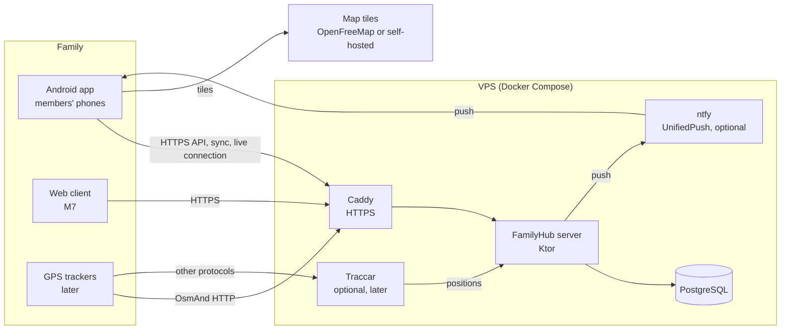

# Architecture overview

Decisions behind this page: ADR-0004 (stack), ADR-0005 (deploy), ADR-0006 (no proprietary deps),
ADR-0008 (sync), ADR-0010 (tenancy), ADR-0012 (modular monolith), ADR-0013 (resources), ADR-0014 (permissions).

## System context



## Server

- One Ktor process, feature modules per ADR-0012:
  `identity`, `household` (persons), `tags`, `tasks`, `shopping`, `calendar`, `location`, `budget`;
  infrastructure: `sync`, `notifications`, `platform`.
- Each feature module: HTTP routes → application services (use cases, permission checks) → domain → persistence.
- All persistence scoped by household (ADR-0010). Migrations versioned in the repo.
- Logic that must match on client and server (recurrence, permissions, allocation, validation) lives in shared KMP code
  used by both (ADR-0004, ADR-0013).
- Background jobs inside the process: routine occurrence generation, overdue detection, reminders for push,
  location retention cleanup, geofence evaluation.

## Client

- Kotlin Multiplatform; Compose Multiplatform UI. Details: [sync.md](sync.md), [auth.md](auth.md), [api.md](api.md).
- Layers: UI (screens, view models, unidirectional data flow) → repositories → local DB + sync engine → HTTP client.
- UI reads from the local DB only; the sync engine pushes the outbox and pulls changes (ADR-0008).
- Android-specific: location foreground service, notification scheduling, UnifiedPush receiver, battery optimization guidance.

## Contract

- KMP module used by server and client: DTOs, route paths, mutation types, validation rules, protocol version.
- A breaking change to the contract requires a protocol version bump and compatibility handling.

## Repository layout (from the M0 plans)

```
contract/                 shared server/client contract and domain logic (KMP)
server/                   Ktor app; feature modules as Gradle subprojects or packages
client/shared/            KMP shared client code (data, sync, domain, UI)
client/android/           Android application shell
client/web/               M7
integration-tests/        multi-device sync tests (server + clients in one JVM)
tools/loadsim/            load simulation CLI
deploy/                   docker-compose.yml, Caddyfile, .env.example, scripts
docs/                     documentation
```

## Cross-cutting

| Concern | Approach |
| --- | --- |
| Auth | Server-issued access + refresh tokens; sessions listable and revocable (FND-011) |
| Permissions | Groups + access rules (ADR-0014); evaluated by shared Kotlin code: offline on the client, authoritatively on the server |
| Time | See [model § value conventions](../domain/model.md#value-conventions) |
| i18n | String resources en/ru in the client; server sends codes, not texts, except push notification texts in the member's language |
| Logging | Structured logs to stdout; no personal data (positions, amounts) in logs |
| Config | Environment variables; `.env.example` documents all of them |
