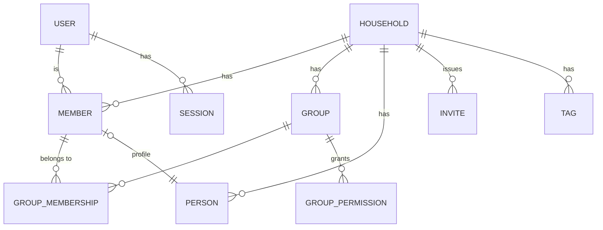
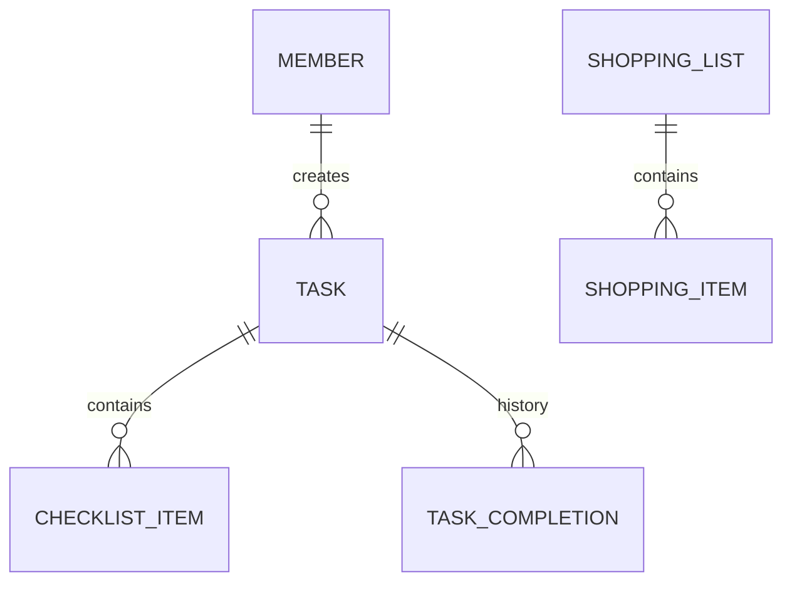
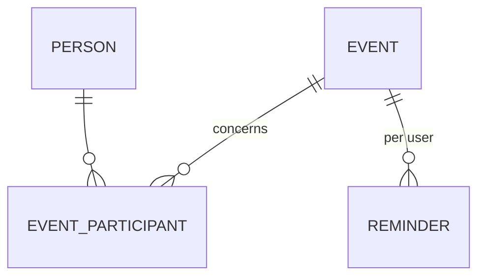
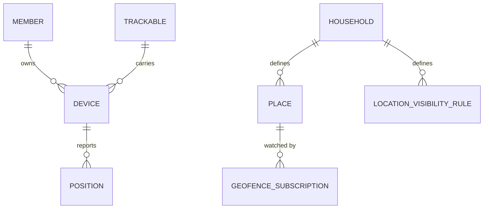
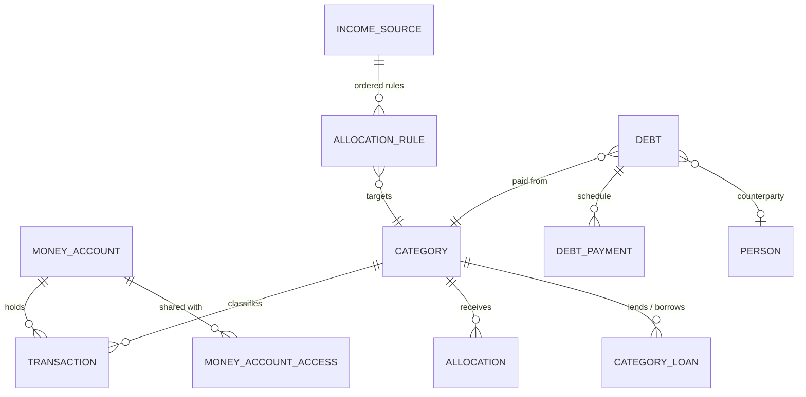

# Domain model

High-level entities and relations. Field-level schemas live with the code (migrations, contract module)
once they exist; this page stays conceptual.

## Common to every syncable entity

`id` (UUIDv7, client-generated), `household_id`, `seq` (last change), `created_at`, `updated_at`, `deleted` (tombstone).
See ADR-0008, ADR-0010.

## Core

- Taggable entities carry `tagIds` (a set of tag ids) in their own data; there is no link entity (ADR-0018).
- Access rules (location visibility, money account access) have a subject and a target, each a group or a member (ADR-0014).

## Tasks and shopping (M1, M2)

- A routine is a task with a recurrence rule. Occurrences are computed from the task and its completions, not stored
  (ADR-0017); assignees and tags are id sets inside the task. Design: [architecture/tasks.md](../architecture/tasks.md).

## Calendar (M3)

- Birthdays are derived from `PERSON.birth_date`, not stored as events.

## Location (M4; trackers later)

- `POSITION` is append-only, not synced through the general mechanism, deleted after retention.

## Budget (M5)

- Amounts: integer minor units + ISO 4217 currency.

## Value conventions

| Kind | Representation |
| --- | --- |
| Point in time | UTC instant |
| Event time | instant + IANA time zone id |
| All-day date, birthday | local date (no zone); year may be unknown |
| Money | `Long` minor units + currency code |
| Coordinates | WGS84 latitude/longitude as doubles |
